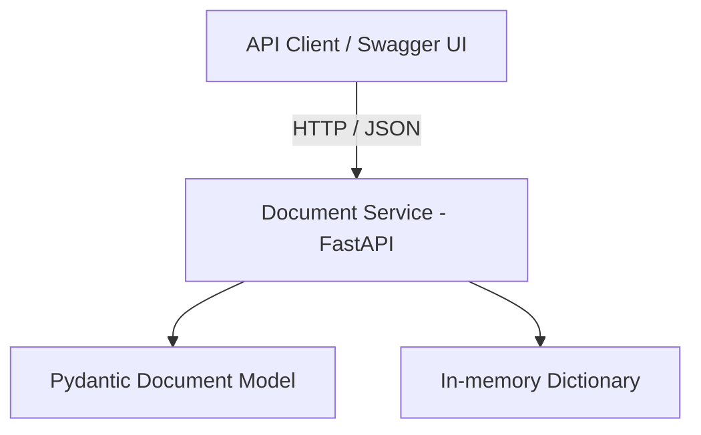
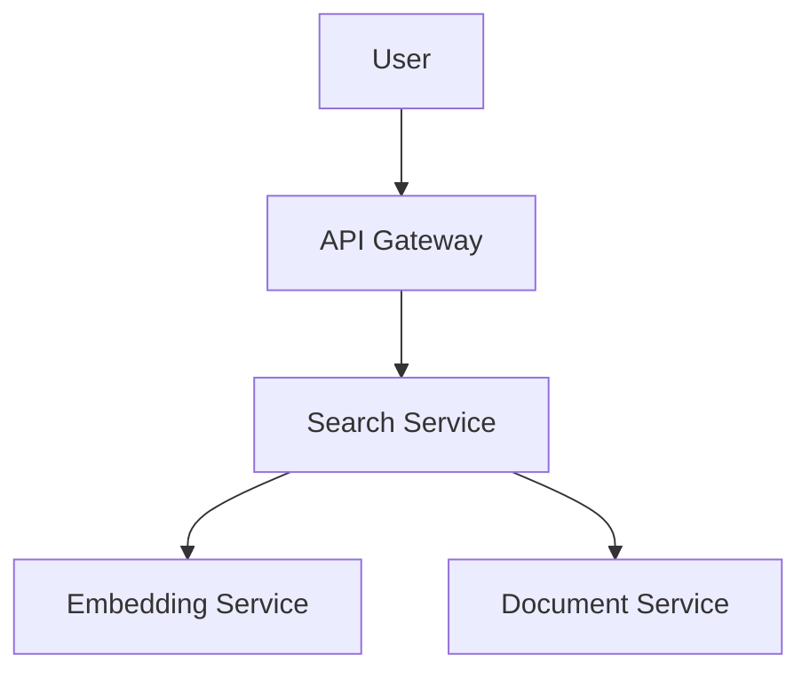
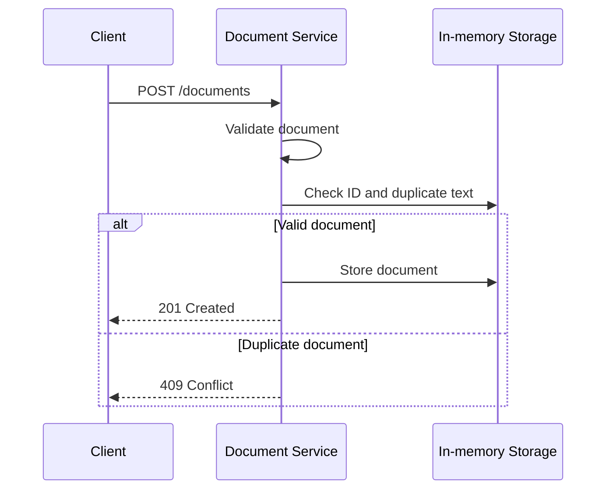

# Document Service

## 1. Project Description

Document Service is a microservice developed as part of a larger Semantic Search application.

Its main responsibility is storing and retrieving text documents that will later be used by the semantic search system.

The service exposes a REST API using FastAPI and communicates through HTTP requests with JSON data.

The current implementation uses an in-memory Python dictionary. Persistent storage using SQLite is planned for a later development stage.

## 2. Service Responsibilities

Document Service is responsible for:

- Storing document records.
- Retrieving all stored documents.
- Retrieving a document by its unique ID.
- Validating incoming document data.
- Preventing duplicate document identifiers.
- Preventing documents with identical normalized text.

The service does not generate embeddings, perform similarity calculations, or execute searches. These responsibilities belong to other components of the Semantic Search application.

## 3. Document Data Model

Each document contains the following fields:

| Field | Type | Description |
|---|---|---|
| id | string | Unique document identifier |
| title | string | Document title |
| description | string | Short document description |
| text | string | Full document content |

Example document:

```json
{
    "id": "doc-001",
    "title": "Artificial Intelligence",
    "description": "Introduction to AI",
    "text": "Artificial intelligence is a field of computer science."
}
```

The document ID is provided by the client in the current implementation.

## 4. Microservice Architecture

The Document Service is one component of a planned microservice-based Semantic Search application.

### 4.1 Planned Services

| Service | Responsibilities | Main data |
|---|---|---|
| Document Service | Stores and retrieves documents | Document records |
| Embedding Service | Converts text into numerical vectors | Generated embeddings |

The Document Service owns the source document records. The Embedding Service processes text and returns vector representations but does not own document records.

### 4.2 Planned Communication Contract

The planned communication between these services will use REST over HTTP with JSON.

| Caller | Target | Operation | Purpose |
|---|---|---|---|
| Embedding Service | Document Service | GET /documents/{id} | Retrieve document text when needed |
| Embedding Service | Document Service | GET /documents | Retrieve available documents for processing |

The actual service-to-service integration will be implemented in a later development stage.

### 4.3 Architecture Diagram – Current Service



### 4.4 Architecture Diagram – Planned Microservices



### 4.5 Architecture Diagram – Document Creation



## 5. API Documentation

The service currently exposes four endpoints.

| Method | Endpoint | Description | Success |
|---|---|---|---|
| GET | /health | Health check | 200 |
| GET | /documents | Retrieve all documents | 200 |
| GET | /documents/{document_id} | Retrieve one document | 200 |
| POST | /documents | Create a new document | 201 |

### 5.1 GET /health

Checks whether the service is running.

Example response:

```json
{
    "status": "healthy",
    "service": "document-service"
}
```

Status code: `200 OK`.

### 5.2 GET /documents

Returns all stored documents.

Example response:

```json
[
    {
        "id": "doc-001",
        "title": "Artificial Intelligence",
        "description": "Introduction to AI",
        "text": "Artificial intelligence is a field of computer science."
    }
]
```

If no documents exist, the service returns an empty list:

```json
[]
```

Status code: `200 OK`.

### 5.3 GET /documents/{document_id}

Returns a document with the specified identifier.

Example request:

```http
GET /documents/doc-001
```

A successful request returns the document with status `200 OK`.

If the document does not exist, the service returns:

```json
{
    "detail": "Document with ID 'doc-999' not found"
}
```

Status code: `404 Not Found`.

### 5.4 POST /documents

Creates a new document.

Example request:

```http
POST /documents
Content-Type: application/json
```

Request body:

```json
{
    "id": "doc-001",
    "title": "Artificial Intelligence",
    "description": "Introduction to AI",
    "text": "Artificial intelligence is a field of computer science."
}
```

Successful response:

```json
{
    "id": "doc-001",
    "title": "Artificial Intelligence",
    "description": "Introduction to AI",
    "text": "Artificial intelligence is a field of computer science."
}
```

Status code: `201 Created`.

## 6. Business Rules and Validation

The service implements two business rules.

### 6.1 Unique Document Identifiers

Each document must have a unique identifier.

An attempt to create another document with an existing ID results in `409 Conflict`.

### 6.2 Duplicate Content Prevention

The service does not allow two documents with identical normalized text.

Text normalization:
- Ignores letter case.
- Removes leading and trailing whitespace.
- Replaces sequences of whitespace characters with a single space.

Example:

```text
"Hello WORLD"
"hello world"
" 