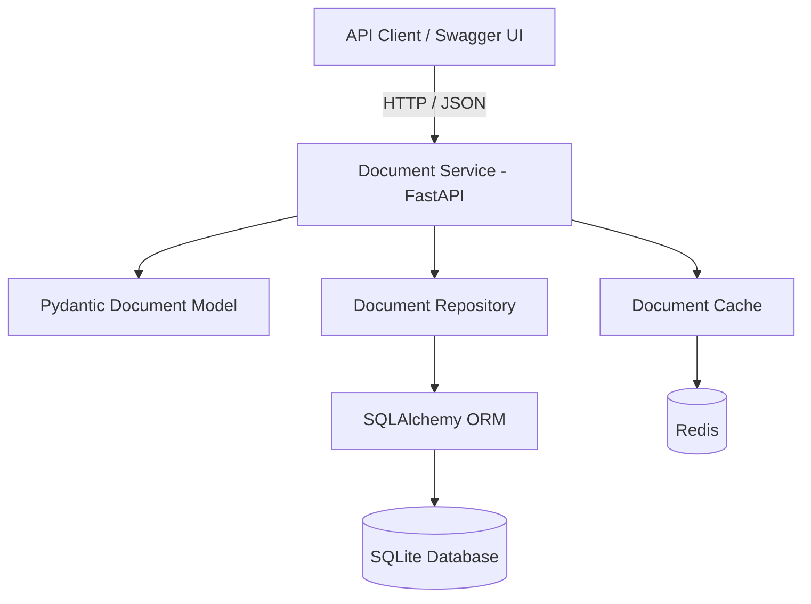
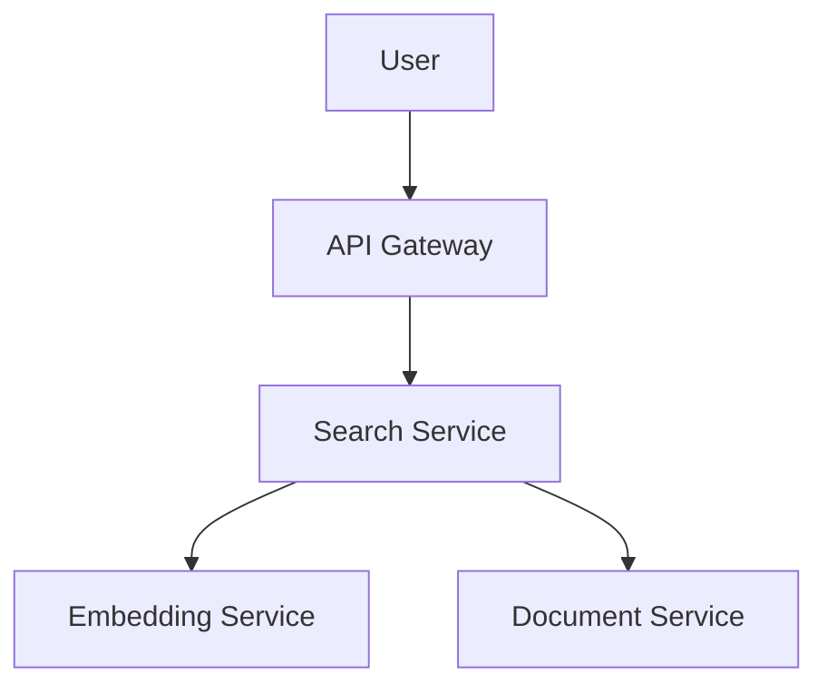
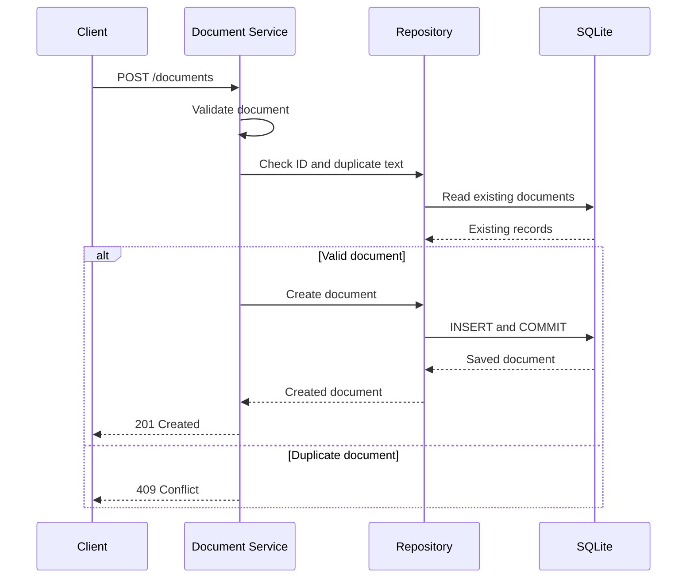
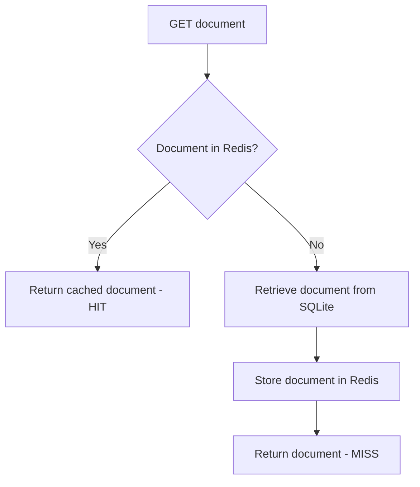

# Document Service

## 1. Project Description

Document Service is a microservice developed as part of a larger Semantic Search application.

Its main responsibility is storing and retrieving text documents that will later be used by the semantic search system.

The service exposes a REST API using FastAPI and communicates through HTTP requests with JSON data.

In LAB2, the service was extended with persistent storage using SQLite and SQLAlchemy. Redis was introduced as a cache for document retrieval.

SQLite is the primary and persistent data store. Redis contains temporary copies of selected document data to reduce repeated database reads.

## 2. Service Responsibilities

Document Service is responsible for:

- Storing document records.
- Retrieving all stored documents.
- Retrieving a document by its unique ID.
- Creating new documents.
- Updating existing documents.
- Validating incoming document data.
- Preventing duplicate document identifiers.
- Preventing documents with identical normalized text.
- Persisting document data in SQLite.
- Caching selected document reads using Redis.

The service does not generate embeddings, perform similarity calculations, or execute searches. These responsibilities belong to other components of the Semantic Search application.

## 3. Document Data Model

Each document contains the following fields:

| Field | Type | Description |
|---|---|---|
| id | string | Unique document identifier and primary key |
| title | string | Document title |
| description | string | Short document description |
| text | string | Full document content |

Example document:

```json
{
  "id": "doc-001",
  "title": "Artificial Intelligence",
  "description": "Introduction to AI",
  "text": "Artificial intelligence is a field of computer science."
}
```

The document ID is provided by the client.

### 3.1 Pydantic and SQLAlchemy Models

The service separates API validation from database persistence.

- The Pydantic `Document` model defines the API data structure and validates incoming requests.
- The SQLAlchemy `DocumentDB` model represents the database table and its columns.

The `documents` table stores the document records. The `id` field is the primary key.

## 4. Microservice Architecture

The Document Service is one component of a planned microservice-based Semantic Search application.

### 4.1 Planned Services

| Service | Responsibilities | Main data |
|---|---|---|
| Document Service | Stores and retrieves documents | Document records |
| Embedding Service | Converts text into numerical vectors | Generated embeddings |

The Document Service owns the source document records. The Embedding Service processes text and returns vector representations but does not own document records.

### 4.2 Planned Communication Contract

The planned communication between these services will use REST over HTTP with JSON.

| Caller | Target | Operation | Purpose |
|---|---|---|---|
| Embedding Service | Document Service | GET /documents/{id} | Retrieve document text when needed |
| Embedding Service | Document Service | GET /documents | Retrieve available documents for processing |

The actual service-to-service integration will be implemented in a later development stage.

### 4.3 Current Document Service Architecture

The current implementation uses the following components:

- FastAPI handles HTTP requests and responses.
- Pydantic validates API data.
- DocumentRepository handles database operations.
- SQLAlchemy provides ORM functionality and database sessions.
- SQLite stores persistent document records.
- DocumentCache handles cache operations.
- Redis stores cached document data.



### 4.4 Planned Microservices Architecture



### 4.5 Document Creation Flow



## 5. API Documentation

The service exposes five endpoints.

| Method | Endpoint | Description | Success |
|---|---|---|---|
| GET | /health | Health check | 200 |
| GET | /documents | Retrieve all documents | 200 |
| GET | /documents/{document_id} | Retrieve one document | 200 |
| POST | /documents | Create a new document | 201 |
| PATCH | /documents/{document_id} | Update an existing document | 200 |

### 5.1 GET /health

Checks whether the service is running.

Example response:

```json
{
  "status": "healthy",
  "service": "document-service"
}
```

Status code: `200 OK`.

### 5.2 GET /documents

Returns all stored documents.

Example response:

```json
[
  {
    "id": "doc-001",
    "title": "Artificial Intelligence",
    "description": "Introduction to AI",
    "text": "Artificial intelligence is a field of computer science."
  }
]
```

If no documents exist, the service returns an empty list:

```json
[]
```

Status code: `200 OK`.

### 5.3 GET /documents/{document_id}

Returns a document with the specified identifier.

Example request:

```http
GET /documents/doc-001
```

A successful request returns the document with status `200 OK`.

This endpoint uses Redis caching.

The response includes an `X-Cache` header:

| Header | Meaning |
|---|---|
| MISS | Document was not found in Redis and was retrieved from SQLite |
| HIT | Document was found in Redis |
| BYPASS | Redis was unavailable and the application retrieved data directly from SQLite |

If the document does not exist, the service returns:

```json
{
  "detail": "Document with ID 'doc-999' not found"
}
```

Status code: `404 Not Found`.

### 5.4 POST /documents

Creates a new document.

Example request:

```http
POST /documents
Content-Type: application/json
```

Request body:

```json
{
  "id": "doc-001",
  "title": "Artificial Intelligence",
  "description": "Introduction to AI",
  "text": "Artificial intelligence is a field of computer science."
}
```

Successful response returns the created document.

Status code: `201 Created`.

If the document ID already exists or another document has identical normalized text, the service returns `409 Conflict`.

### 5.5 PATCH /documents/{document_id}

Updates selected fields of an existing document.

The request can contain one or more fields:

- title
- description
- text

Example request:

```http
PATCH /documents/doc-001
Content-Type: application/json
```

Request body:

```json
{
  "title": "Updated Artificial Intelligence"
}
```

The service updates the document in SQLite and invalidates its Redis cache entry after the database transaction has been committed.

A successful request returns the updated document.

Status code: `200 OK`.

If the document does not exist, the service returns `404 Not Found`.

Invalid update data returns `422 Unprocessable Entity`. An update that would create duplicate normalized text returns `409 Conflict`.

## 6. Business Rules and Validation

The service implements business rules inherited from LAB1.

### 6.1 Unique Document Identifiers

Each document must have a unique identifier.

An attempt to create another document with an existing ID results in `409 Conflict`.

The database also enforces uniqueness through the primary key constraint.

### 6.2 Duplicate Content Prevention

The service does not allow two documents with identical normalized text.

Text normalization:

- Ignores letter case.
- Removes leading and trailing whitespace.
- Replaces sequences of whitespace characters with a single space.

Example:

```text
"Hello WORLD"
"hello world"
"  hello   world  "
```

These values are treated as identical content.

The same business rule is checked when creating a document and when updating its text.

### 6.3 Invalid Requests

Incoming document data is validated using Pydantic.

Invalid data is rejected before it can be persisted.

The service uses HTTP `422 Unprocessable Entity` for validation errors.

Rejected operations must not leave partially written or inconsistent document data.

## 7. Persistent Storage

### 7.1 SQLite

LAB2 replaces the in-memory dictionary used in LAB1 with persistent SQLite storage.

SQLite stores the document records in a local database file.

Default database URL:

```text
sqlite:///./document-service/app.db
```

The database schema is initialized when the application starts.

The database is the authoritative source of document data. Redis is not used as the primary storage system.

### 7.2 SQLAlchemy

SQLAlchemy is used as the Object-Relational Mapping (ORM) layer.

The main database components are:

| Component | Responsibility |
|---|---|
| Base | Declarative base for ORM models |
| Engine | Manages database connections |
| Session | Manages database operations and transactions |
| Session factory | Creates independent database sessions |
| DocumentDB | Represents the documents table |
| DocumentRepository | Encapsulates document database operations |

Each database operation uses its own session.

Successful write operations are committed to SQLite. If a database operation fails, the transaction can be rolled back.

The database session is closed after the operation.

### 7.3 Persistence After Restart

Unlike the in-memory dictionary used in LAB1, SQLite stores data in a file.

Therefore, restarting the Uvicorn process does not remove previously saved documents.

This behavior was verified manually by:

1. Creating a document.
2. Stopping the Uvicorn process.
3. Starting the application again with the same database configuration.
4. Retrieving the previously created document.

The document remained available after restart.

## 8. Redis Cache

### 8.1 Purpose of Cache

Redis is used to reduce repeated database reads for frequently requested documents.

Only the detail endpoint is cached:

```http
GET /documents/{document_id}
```

The cache stores a JSON representation of the document.

SQLite remains the authoritative source of document data.

### 8.2 Cache-Aside Strategy

The service uses the Cache-Aside pattern.

The read operation follows these steps:

1. The application checks Redis for the requested document.
2. If the document exists in Redis, the cached value is returned.
3. If the document is missing, the application retrieves it from SQLite.
4. The retrieved document is stored in Redis.
5. Subsequent requests can use the cached value.



### 8.3 Cache Key

Each document uses a cache key based on its ID.

Key format:

```text
lab2:document-service:document:{document_id}
```

Example:

```text
lab2:document-service:document:doc-001
```

### 8.4 Time To Live (TTL)

Cached documents have a limited lifetime.

The default TTL is 60 seconds.

After expiration, Redis removes the cached entry. The next read is therefore handled as a cache miss and retrieves the current document from SQLite.

TTL prevents cached data from remaining indefinitely.

### 8.5 Cache Invalidation

When a document is successfully updated, the service first commits the change to SQLite and then attempts to invalidate the corresponding Redis key.

This order ensures that the database remains the primary source of truth.

After successful invalidation:

1. The next GET request returns `MISS`.
2. The application retrieves the updated document from SQLite.
3. The new document representation is stored in Redis.
4. Subsequent requests return `HIT` with the updated data.

### 8.6 Redis Failure Handling

Redis is an optional performance component and must not prevent access to persistent document data.

When Redis is unavailable:

- GET requests bypass the cache and retrieve documents from SQLite.
- POST requests can still save documents to SQLite.
- PATCH requests can still update documents in SQLite.
- Redis errors must not roll back an already committed database transaction.

The application catches Redis-related errors and continues using SQLite.

### 8.7 Cache Consistency Limitations

Redis contains a temporary copy of data stored in SQLite.

If cache invalidation fails after a successful database commit, an old cached value could remain available until its TTL expires or the cache entry is removed.

This means that cache invalidation is best-effort when Redis is unavailable.

The TTL limits how long such stale data can remain in Redis.

When Redis cannot be accessed, the application bypasses it and reads directly from SQLite.

## 9. Configuration and Running the Application

### 9.1 Technologies

| Technology | Purpose |
|---|---|
| Python | Programming language |
| FastAPI | REST API framework |
| Pydantic | Request validation and data models |
| SQLAlchemy | ORM and database access |
| SQLite | Persistent document storage |
| Redis | Cache |
| redis-py | Python Redis client |
| Docker | Running Redis locally |
| pytest | Automated tests |

### 9.2 Dependencies

Install the project dependencies from the repository root:

```powershell
.\.venv\Scripts\python.exe -m pip install -r .\document-service\requirements.txt
```

The main LAB2 dependencies include SQLAlchemy and redis-py.

### 9.3 Starting Redis

The project uses Redis 7 in a Docker container.

Create the container for the first time:

```powershell
docker run --name lab2-redis -p 127.0.0.1:6379:6379 -d redis:7-alpine
```

If the container already exists, start